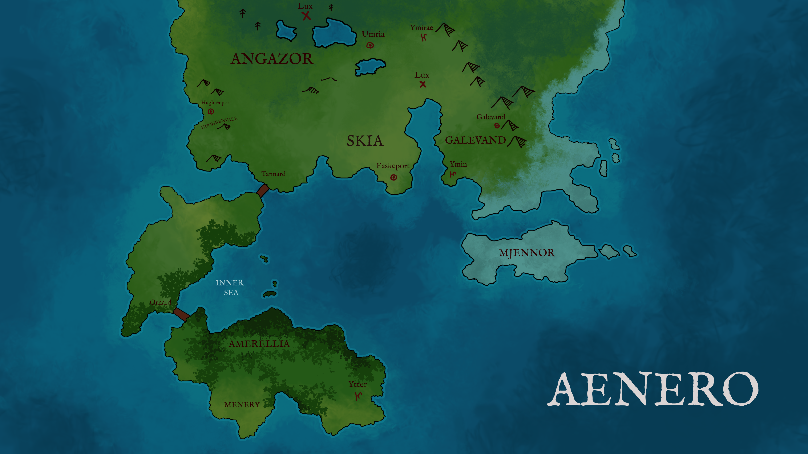

# Стражи Аэнеро

Приключение для D&amp;D 5E

## О приключении

## Государства

- [Ския](/skia.html)
- [Ангазор](/angazor.html)
- [Галеванд](/galevand.html)
- [Ингвион](/ingvion.html)

## Персонажи

- **Аменофис** -- мастер боевых искусств, самый умный человек в мире
- **Менестрель** -- наёмник-бард, груб и хамоват
- **Профессор Шлиман**
- **Консул Илая**
- **Канцлер Адрехт**
- **Кронпринц Эдвард XXXIV**
- **Министр труда Воррен**
- **Клерк Аргентий**
- **Придворный маг 
