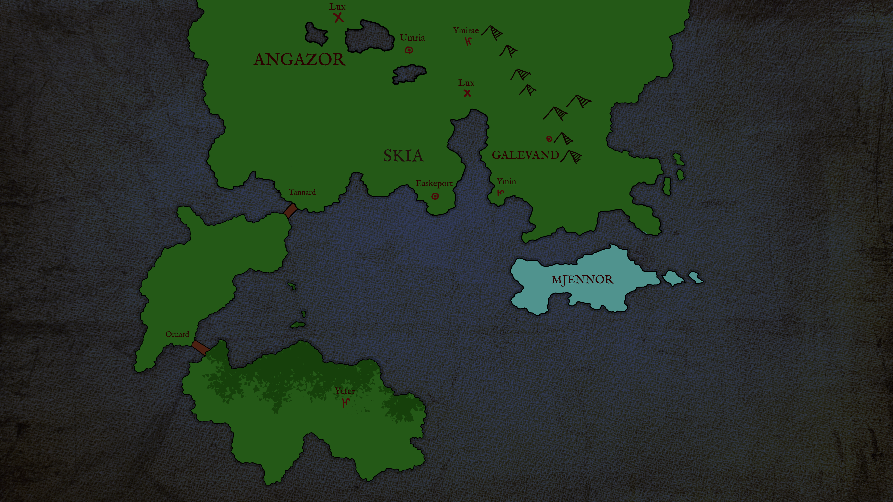

# Стражи Аэнеро

Приключение для D&amp;D 5E

## О приключении

## Государства

- [Ския](/skia)
- [Ангазор](/angazor)
- [Галеванд](/galevand)
- [Ингвион](/ingvion)

## Персонажи

- **Аменофис / Адриан Шелли** -- мастер боевых искусств, самый умный человек в мире
- **Менестрель / Джон Морган** -- наёмник-бард, груб и хамоват
- **Профессор Шлиман**
- **Консул Илая**
- **Канцлер Адрехт**
- **Кронпринц Эдвард XXXIV**
- **Министр труда Воррен**
- **Клерк Аргентий**
- **Придворный маг Шеллиум Вес**
